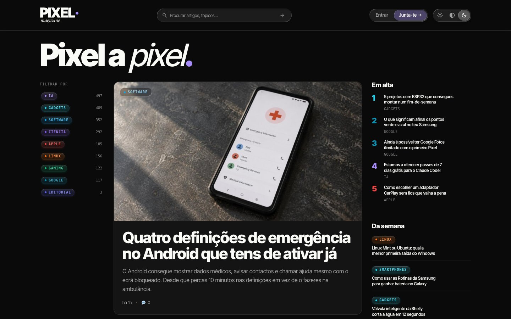
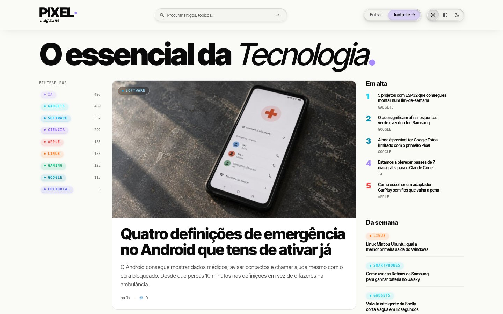
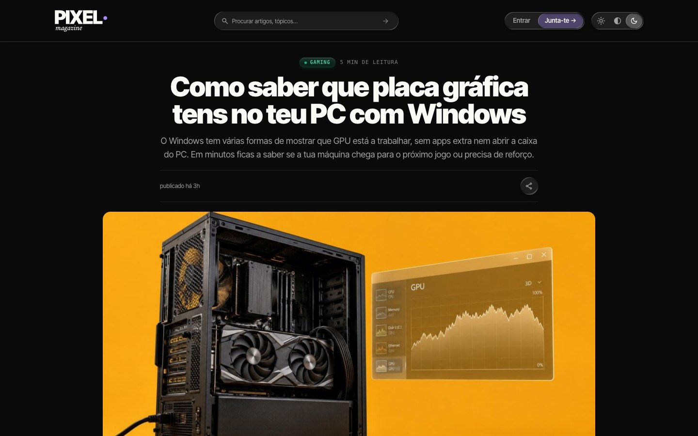
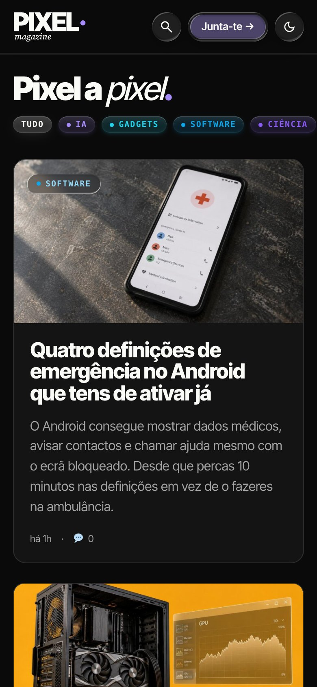
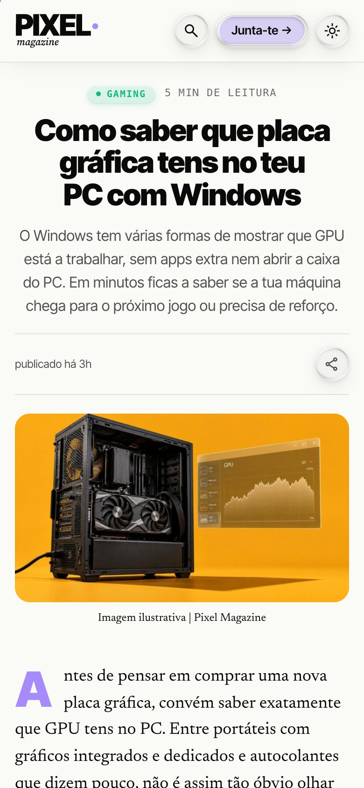

# Pixel Magazine — WordPress theme

The custom theme behind [pixelmagazine.pt](https://pixelmagazine.pt), an independent Portuguese tech publication I built and run on my own.

Classic PHP theme (no page builder), Sass + Vite for the front end, and a set of small modules in `inc/` for the things the site needs day to day.



<p>
  
  
</p>

<p align="center">
  
  
</p>

## What's in here

- **Templates** — front page with an editable layout (ACF), article, archive, search, saved posts.
- **`inc/`** — one file per feature:
  - newsletter (sign-up, issues, HTML template, one-click unsubscribe)
  - front-end login/registration modal that keeps the real login URL hidden
  - bookmarks and per-post view history
  - Google News sitemap, SEO meta, GDPR consent (Google Analytics only after consent)
  - Bluesky auto-posting, a Buffer outbox for X, ntfy alerts
  - admin tweaks (dark mode, extra columns)
- **`src/`** — SCSS (design tokens, light/dark themes) and JS.
- **`acf-json/`** — field groups, versioned so they travel with the theme.
- **`bin/build-prod-theme.mjs`** — builds a minified production copy of the theme.

## Engineering notes

- **Hidden login.** Login, registration and password recovery run in a modal. The reset key travels in the URL fragment, so it never reaches server logs, caches or the `Referer`.
- **Built for full-page caching.** View counts use a client-side beacon, and per-visitor blocks are resolved in the browser, so cached HTML is never personalised.
- **Progressive glass UI.** Inset shadows work everywhere, blur is added where supported, and SVG refraction only runs on Chromium devices with enough memory.
- **Content-hashed assets.** Versions come from file contents rather than dates, so a deploy can't leave a stale file cached under a new URL.

## Requirements

WordPress with [Advanced Custom Fields PRO](https://www.advancedcustomfields.com/pro/) (the field groups use repeaters), plus Node.js to build the assets.

Credentials (Bluesky, Buffer, ntfy) and the Google Analytics ID are read from constants defined outside the theme, and each integration stays off without them. None are in this repo.

## Build

```bash
npm install
npm run dev        # Vite dev server
npm run build      # compile assets to dist/
npm run build:prod # build + minified production theme (needs PHP in PATH or PHP_BIN)
```

`build:prod` writes to a sibling `pixelmagazine/` folder when the theme sits inside `wp-content/themes/`, and to `build/pixelmagazine/` in a standalone clone. Set `THEME_BUILD_DEST` to choose another folder named `pixelmagazine`.

## Related

Content for the site comes from an n8n pipeline: RSS sources → AI selection → AI rewrite and cover image → automated checks → scheduled post, or a draft for human review when a check fails. The theme is the publishing side of that setup.

---

Francisco Pedroso · [franciscopedroso.com](https://franciscopedroso.com)
